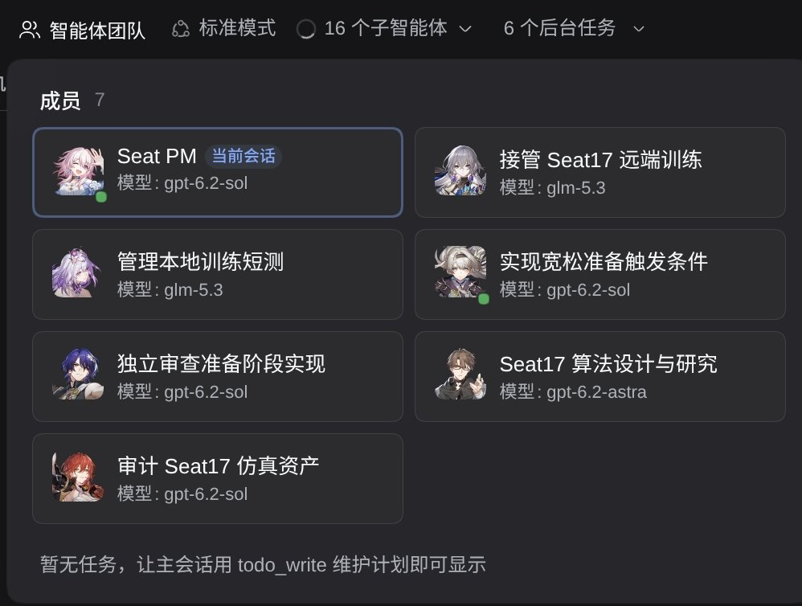

# dsh-team-panel

DeepSeek Harness Web 客户端插件：把官方 experimental Agent Teams 的会话头部下拉面板移植为独立插件，数据改用 stock 投影，不依赖官方 team host 服务与 `spawn_teammate` 工具链。

## 效果展示



面板在会话头部展示成员花名册、当前模型和运行状态；成员卡片支持打开子会话，并可在支持的会话上切换模型。

## 功能

- **成员花名册**：入口挂在会话头部（`conversation.session.header.actions`），悬停/点击展开。首行是主会话（lead），其后是 `subagentCatalog` 投影里的本地子代理（continuable/one-shot；external 不显示）。
- **添加成员**：成员区标题行的 + 按钮弹出创建面板——填写初始任务、可选成员名称，并选择递归深度 1/2/3（默认 1）。深度经 `depthPresets` 映射到 Agent Preset，见[添加成员与递归深度](#添加成员与递归深度)。
- **动态模型显示**：每个成员卡片常驻显示当前使用的模型（`modelSelection.next.model`，即 pending ?? lastUsed），不是悬停才出现。
- **状态**：运行中 / 未运行 / 准备中（unknown 模式子代理），叠加实时 running 状态。运行/准备中以头像角落呼吸绿点表达，文字状态（悬停头像可见）不再占用卡片正文；卡片第二行只显示当前模型。
- **打开成员会话**：点击成员卡片跳转（当前会话与不可跳转的成员置灰）。
- **任务板**：只读展示主会话 `todos` 投影（`todo_write` 工具维护的清单），三态状态点 + 展开收起。
- **子会话模型选择**：打开 continuable 子会话后，在输入框底部使用与主会话相同的原生模型选择器（模型搜索、供应商分组、推理强度）。卡片只显示模型信息，不放切换按钮。子会话通过 `teamPanel/switchModel` 记录选择，下一步模型请求生效，不改变对话历史；已卸载的成员会显示错误，不会自动唤醒。主会话仍使用原生接口。
- **移除成员**：悬停成员卡片右上角出现 ✕，确认后调用 stock `workspace/archiveSession`（`stopActivity: true`）停止其运行并归档会话；父会话无法再唤醒它。会话历史保留，可在 设置 → 插件 → Team panel（Built-in plugin settings 卡片）或侧栏“仅显示已归档”里恢复（`workspace/unarchiveSession`）。花名册通过 `teamPanel/archivedChildren` RPC 过滤已归档子代理。
- **模型视图同步过滤**：host 半边挂了 `tools/post-execute` 监听，改写成功的 `list_agents` 结果——已归档（从团队移除）的成员不再出现在模型可见的智能体列表里。另挂 `tools/pre-execute` 监听：`send_message`/`interrupt_agent` 目标为已移除成员时直接拒绝，并提示可在 Team panel 设置中恢复；恢复后立即放行。
- Host 服务提供头像与模型选择 RPC，不替换 stock subagent 工具。模型目录可列出的路由不保证上游调用成功；切换成功仅表示选择已记录。

## 安装

```sh
dsh plugin --profile web add github:krai33/dsh-team-panel
```

或从本地源码目录安装（`dsh.plugin add <path>` 会同时应用本包自带的 `cordis.patch.yml`；`dsh plugin add` 只写依赖，不写 patch 行），再手工在 `~/.dsh/profiles/web/cordis.patch.yml` 顶部插入：

```yaml
- id: team-panel
  name: dsh-team-panel
```

重启 `dsh --profile web` 生效。

安装会同时带入 [dsh-subagent-model-switch](https://github.com/krai33/dsh-subagent-model-switch)（作为 npm 依赖自动安装并激活，提供 `subagentRoute/switch` CLI，用于对运行中的子代理会话原位切换模型路由）。两者独立工作：面板的核心功能不依赖它。不需要时可在 设置 → 插件 中单独停用，或直接移除：

```sh
dsh plugin --profile web remove dsh-subagent-model-switch
```

若 pnpm 启用了 `blockExoticSubdeps` 并拒绝 git 子依赖，先直接安装伴生包再装本包：

```sh
dsh plugin --profile web add github:krai33/dsh-subagent-model-switch
dsh plugin --profile web add github:krai33/dsh-team-panel
```

## 添加成员与递归深度

成员区标题行的 **+** 按钮不经模型直接创建成员：填写初始任务（必填）、成员名称（可选，缺省取任务首行）并选择递归深度 1/2/3（默认 1）。初始任务像普通委派一样执行，结果回到父会话，成员保留为可持续对话的子代理。

深度决定成员自己还能再委派几层，映射到插件配置 `depthPresets` 指定的 Agent Preset——preset 里的 `tool-subagent` / `tool-subagent-fork` 的 `maxDepth` 就是成员的递归预算：

- **深度 1（默认）**：不可再委派。不配置时沿用父会话的 preset，与模型用 `subagent` 工具生成的成员完全一致。
- **深度 2 / 3**：成员自己可以再委派 1 / 2 层子代理（需声明对应 preset）。

```yaml
# ~/.dsh/profiles/web/cordis.patch.yml
- id: team-panel
  name: dsh-team-panel
  config:
    spawnProvider: spawn            # 可选，默认 spawn
    depthPresets:
      '2': cordis-deep-2
      '3': cordis-deep-3

# 每个深度一份 preset：现有 preset 清单的完整副本，
# 只改两个委派工具的 maxDepth（不声明第二个 preset 时深度 2/3 会被拒绝）。
- id: preset-cordis-deep-2
  name: '@deepseek-ai/dsh-agent-preset'
  config:
    id: cordis-deep-2
    order: 5
    plugins:
      # …与你的主 preset（如 preset-cordis）相同的清单…
      - id: tool-subagent
        name: '@deepseek-ai/dsh-tool-subagent'
        config: { provider: spawn, toolName: subagent, maxDepth: 2 }
      - id: tool-subagent-fork
        name: '@deepseek-ai/dsh-tool-subagent'
        config: { provider: fork, toolName: subagent_fork, maxDepth: 2 }
```

深度 2/3 未配置 preset 时，创建请求以 `teamPanel/depth-unconfigured` 拒绝，不会生成成员。改动 preset 后重启 DSH，新声明只影响之后创建的成员。

## 构建

```sh
npm install --no-save @types/react@19 @types/react-dom@19   # 一次性
python3 scripts/regen-rc1-types.py   # 重建 /tmp/rc1-types + tsconfig.client.json（需 master 仓库在 ../deepseek-harness）
npm run build                        # host tsc + 自有 client 源码类型检查 + tsdown bundle
npm test                             # 构建后运行模型适配器和临时头像库测试
```

产物：`lib/client.js`（浏览器闭包工厂 bundle，`window.__ModuleLoader__.load` 自注册）、`lib/host/index.js`（头像与 live-agent 模型选择服务）。

类型检查的 `tsconfig.client.json` `paths` 指向 master 仓库 rc.1 tag（`2f97f60455`）提取的源码（`/tmp/rc1-types`），与运行时 0.2.2-rc.1 严格一致；提取树自带 dev 依赖噪音（shiki/clsx 等），`scripts/typecheck-client.mjs` 只对插件自身源码报错生效。

## 工作原理

- **客户端装载**：`package.json` 的 `dsh.client` 声明（`platform: web` + `inject` 列表）由 host 侧 `@deepseek-ai/dsh-client-modules` 扫描，自动组成 boot graph；浏览器 shell 通过 `window.__DSH_BOOT__` 拉取 `/plugins/dsh-team-panel/client.js` 并注册工厂。
- **平台外部依赖**：`react`、`react-dom`、`@deepseek-ai/dsh-client-ui-primitives` 等由 loader 的种子表在浏览器内提供，bundle 内是 `require(...)` 调用。
- **数据**：面板只读 stock 投影（`subagentCatalog`、`modelSelection`、`todos`），随会话事件流增量更新，无需轮询。
- **模型选择 UI**：从已安装的原生 `conversation.input.model` 注册取得组件，在子会话的 `conversation.input.right` 扩展位复用；不修改原生注册或主会话行为。子会话使用原生默认模型标签（含 badge），不转发第三方标签扩展。目录读取 Host 级 `session/modelCatalog`，无需保持父会话页面打开；选择只走 `teamPanel/switchModel`，不会通过原生 Agent-bound RPC 激活历史会话。
- **文案**：通过 `ctx.locale.register('team-panel', { zh, en })` 注册，slot 注册带 `locale: NS` 使 `t` 注入。

## 与官方 experimental 版的差异

| | 官方 experimental | 本插件 |
|---|---|---|
| 成员来源 | `agentTeam` 投影（需 host team 服务 + spawn_teammate 工具链） | `subagentCatalog` stock 投影 |
| 任务来源 | team task board（`team_task_*` 工具） | `todos` 投影（`todo_write`） |
| 模型显示 | 悬停成员卡片才出现 | 常驻显示 |
| host 依赖 | dsh-experimental-agent-team 全家桶 | 无 |

## 成员头像

成员卡片左侧的图标可以点击：

- **卡片上**：点击头像打开图片选择菜单。选择图片只更改当前成员；“恢复默认图标”只清除当前成员的分配。运行中的头像继续显示角落状态点。
- **删除图片**：点击头像菜单里自定义图片旁的垃圾桶并确认。图片从插件头像库移除，所有使用它的成员恢复默认头像；内置图片及上传前的原图不受影响。
- **插件设置面板**：设置 → 插件 → Team panel，每个 lead/成员一行下拉框，预先配置好映射（不必点开 team 面板）。
- **添加图片**：把图片文件（png/jpg/jpeg/gif/webp/svg）放进本仓库 `data/assets/` 目录即可，无需改代码；映射存 `data/avatars.json`（sessionId → 文件名）。
- 图片通过 client-modules 包资产路由下发（`/plugins/dsh-team-panel/assets/<file>`），浏览器带 cookie 访问。

`teamPanel` 的头像接口串行处理目录和分配变更，并原子保存分配。删除仅接受头像库中非内置的普通图片文件；上传使用唯一文件名，避免重新上传时复用已缓存的图片地址。

## 已知限制

- 只显示 lead 会话直接子代理（孙代不展开）。
- `todos` 是 `SessionProjectionSummaryExcluded`：只有打开过该会话（control/follow baseline 已拉取）才有值；主会话在当前视图打开时天然满足。
- rc.1 运行时专用；图标/Hook 与 rc.4 的 primitives 存在 API 差异，升级 dsh 前需对照更新。

## License

MIT
